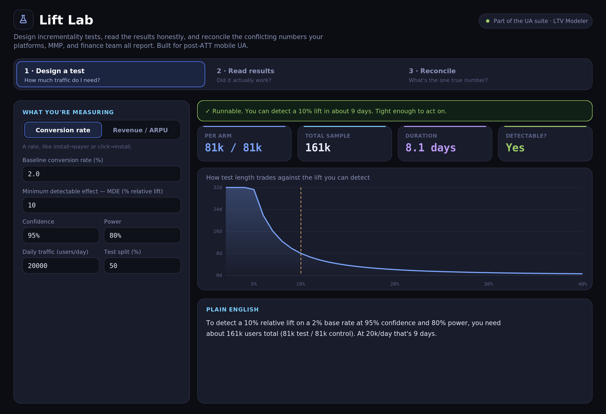
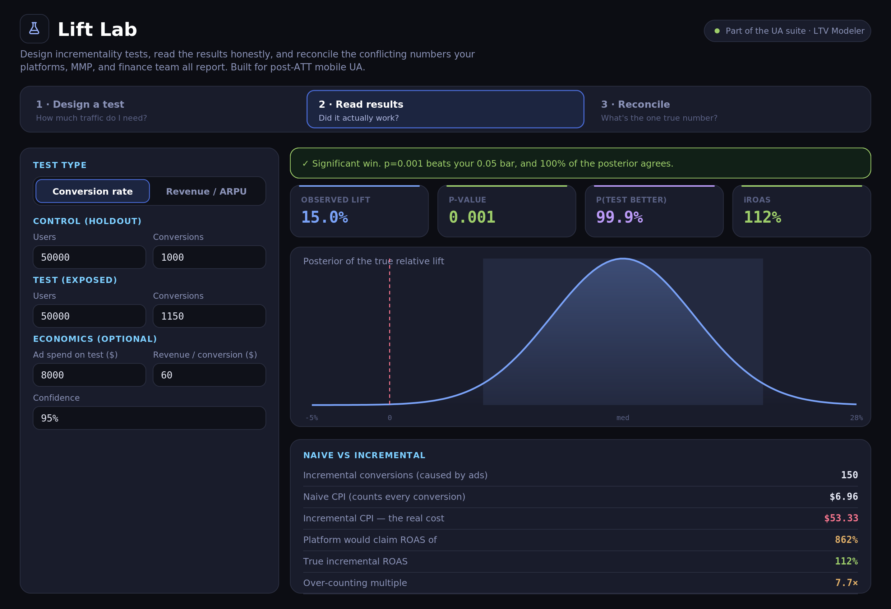

# 🧪 Lift Lab: Mobile UA Incrementality

[](https://stonedhawk.github.io/mobile-ua-incrementality-lab/)

[](LICENSE)
[](#)
[](#)

**A browser calculator for mobile UA holdout tests.** It sizes a test, reads the result (p-value and Bayesian probability), compares naive platform-style ROAS with incremental ROAS, and blends conflicting ROAS figures from several sources into one trust-weighted number. All calculation runs in the page. There is no backend, and nothing you enter is sent anywhere. The only network request is the Google Fonts stylesheet.

### ▶ Try it live: **[stonedhawk.github.io/mobile-ua-incrementality-lab](https://stonedhawk.github.io/mobile-ua-incrementality-lab/)**



---

## 🎯 Three tabs

**1. Design a test.** Pick a metric (conversion rate or revenue), the smallest relative lift you want to detect (MDE), confidence, power, daily traffic and the test/holdout split. It returns users per arm, total users and test length in days, with a verdict: runnable (21 days or less), borderline (over 21, up to 45 days) or not realistic (over 45 days).

**2. Read the results.** Enter control and test numbers. For conversion tests it returns the relative lift, a two-sided p-value, the probability the test arm is better (8,000 Monte Carlo draws over Beta posteriors), a chart of the posterior lift with its 95% credible band, and naive CPI and ROAS next to incremental CPI and ROAS with the over-counting multiple. Revenue tests use a normal approximation for the probability and report incremental revenue and incremental ROAS.

With the default inputs (50,000 users per arm, 1,000 vs 1,150 conversions, $8,000 spend, $60 per conversion) the tool shows a naive ROAS of 863% against an incremental ROAS of 112%, a 7.7x over-count.

**3. Reconcile.** Enter the ROAS each source reports (the defaults are labelled platform, MMP, SKAN and finance), a trust weight and a bias factor. It divides each value by its bias, takes the trust-weighted average, and shows the lowest to highest corrected value as a disagreement band. This is a weighted opinion, not a measurement.

Most inputs and result cards have a tooltip, and a Methods section inside the tool lists every formula.



---

## 🧮 Methods

| Step | Method |
|------|--------|
| **Sample size (rates)** | Two-proportion normal approximation; unequal splits inflated by `1/(4·s·(1-s))` |
| **Sample size (revenue)** | `n/arm = 2·(z₁₋α/2+z₁₋β)²·CV²/MDE²`, with the coefficient of variation (CV) standing in for skewed revenue |
| **Reading a test** | Relative lift, standard error, two-sided z and p-value; the selected confidence sets the significance bar |
| **Bayesian readout** | `Beta(conv+1, non-conv+1)` posteriors, 8,000 Monte Carlo draws for P(better) and the 95% credible band (conversion tests). Revenue tests: normal approximation |
| **Incremental economics** | Incremental conversions = (rate_test − rate_control)·n_test; from there iCPI and iROAS |
| **Reconciliation** | Trust-weighted average of bias-corrected sources; band = lowest to highest corrected value |

---

## ✅ Checking the math

[`checks/expected_values.py`](checks/expected_values.py) recomputes the worked examples below with scipy and statsmodels, from the formulas above rather than from `index.html`. The "Tool shows" column is what the live page displayed for the same inputs.

| Example | Expected (script) | Tool shows |
|---------|-------------------|------------|
| Design, conversion: 2% base, 10% MDE, 95% / 80%, 20,000/day, 50/50 | 80,681 per arm (statsmodels: 80,681), 8.07 days | 81k / 81k, 161k, 8.1 days |
| Design, revenue: CV 4, 5% MDE, 90% / 90%, 50,000/day, 30/70 | 78,298 test / 182,695 control (statsmodels per-arm n within 0.001%), 5.22 days | 78k / 183k, 261k, 5.2 days |
| Design, conversion: 5% base, 3% MDE, 99% / 95%, 10,000/day, 20/80 | 2,383,843 total, 238.4 days | 2.38M, 238 days, "Not realistic" |
| Read, conversion: defaults | lift 15.0%, p 0.00107, P(better) 99.95%, iCPI $53.33, naive ROAS 862.5%, iROAS 112.5%, 7.67x | 15.0%, 0.001, 100.0%, $53.33, 863%, 112%, 7.7x |
| Read, conversion: 20,000 / 400 vs 20,000 / 430, $3,000, $25 | lift 7.5%, p 0.2927, P(better) 85.35% (exact integral), iROAS 25%, 14.33x | 7.5%, 0.293, 84.4% to 86.0% over 20 runs, 25%, 14.3x |
| Read, revenue: defaults | lift 12.0%, p 0.00001, incremental revenue $3,000, iROAS 37.5% | 12.0%, <0.001, $3000, 38% |
| Reconcile: defaults | blend 95.8%, band 78.0% to 111.5% | 96%, 78 to 112% |
| Reconcile: (220, 20, 1.6), (90, 70, 1.1), (60, 40, 0.8), (88, 100, 1.0) | blend 88.2%, band 75.0% to 137.5% | 88%, 75 to 138% |

Every value matches within display rounding and Monte Carlo noise. Two display notes: the duration card rounds (8.1 days) while the verdict rounds up (9 days), and both default ROAS values are exact halves (862.5%, 112.5%) that the page rounds in opposite directions because of floating point.

---

## ⚠️ Limits

A calculator designs and reads tests. It can't run a clean holdout for you, and a contaminated test/control split produces confident nonsense. When your traffic can't detect the lift you asked for within 45 days, the design tab says so. The reconcile tab is a structured way to combine conflicting numbers, not a substitute for measuring.

---

## 🚀 Run it

Use the **[hosted version](https://stonedhawk.github.io/mobile-ua-incrementality-lab/)**, or run it locally. It's one file with no build step:

```bash
git clone https://github.com/stonedhawk/mobile-ua-incrementality-lab.git
open mobile-ua-incrementality-lab/index.html
```

`open` is macOS; on other systems open `index.html` in any browser.

---

## 📄 License

[MIT](LICENSE). Use it inside your studio or fork it freely.

---

Companion to the [LTV &amp; ROAS Modeler](https://stonedhawk.github.io/mobile-ltv-roas-modeler/). Built by [Rahul Shah](https://github.com/stonedhawk), 16 years producing mobile games by day, packaging producer problems into tools by night.
